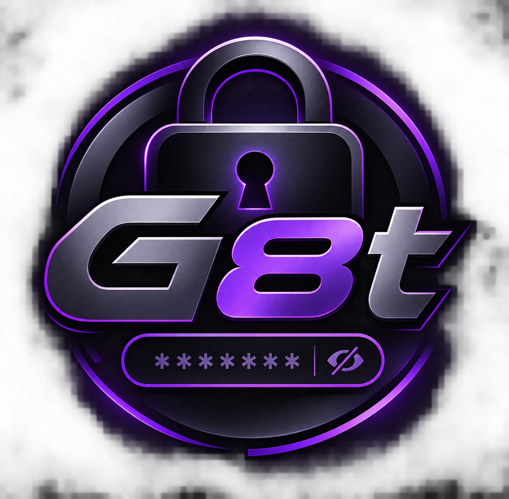

# G8t - gestionnaire de mots de passe "bas niveau" :

## Features :
 - ✅ Base de données SQLite : Tes comptes sont sauvegardés de façon persistante. 
 - ✅ Chiffrement robuste : Tes mots de passe sont chiffrés avec libsodium (XChaCha20-Poly1305) avant d'être stockés.
 - ✅ Mot de passe maître : L'application refuse de s'ouvrir sans le bon mot de passe, vérifié grâce au sel (Argon2id) et au vérificateur.
 - ✅ Interface soignée : Un design sombre moderne, un tableau propre, et un bouton œil pour révéler les mots de passe et bouton pour copier les mots de passe et la corbeille pour suprimmer le compte.

## Information (IMPORTANT) ❗ :
 - ❗ lors de la première au niveau du mots de passe c'est a se moment ou vous initialiser celui-ci ❗

## Installation by Git :
	Clone the repository: git clone https://github.com/Travisyet/G8t.git
